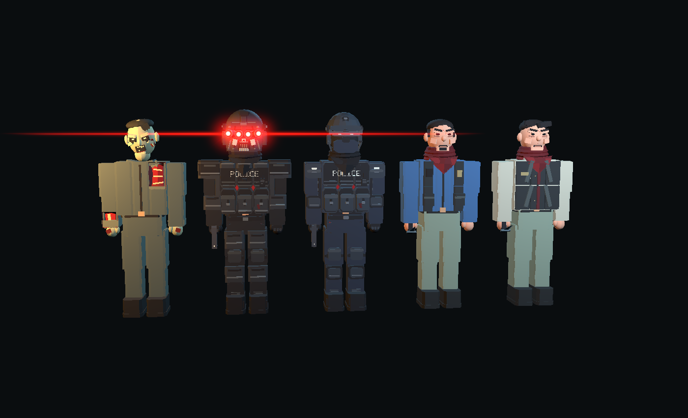

# Night Deposit

A stylized first-person Unity prototype with a bank heist and a combat sandbox.

Open the project with **Unity 6000.3.21f1**. The enabled scenes are `Assets/Scenes/FacilityPrototype.unity` (title and sandbox) and `Assets/Scenes/StoryLevel01.unity` (Night Deposit). Start from the title scene to choose a mode. Package versions are pinned in `Packages/manifest.json` and `Packages/packages-lock.json`.

In Story mode, collect your equipment from the car's trunk, retrieve both the cash and gold, defeat the final SWAT squad, and enter the driver's seat to escape. Collecting the second loot item stops ordinary reinforcements and starts a pulsing red warning and eerie music before four elite officers arrive. No more waves follow, and every elite must be killed before leaving. A successful run saves a $2,500 payout. The shop saves weapon ownership: pistol included, shotgun $5,000, AK-47 $10,000. Attacking the receptionist triggers the alarm and police response.

The characters use simple stylized anatomy with removable wound panels, physical blood and tissue, head destruction, severable limbs, ragdoll recovery, and crawling. Police wear segmented armor and full charcoal neck wraps; observers wear red versions. Layered folds cover the neck and a triangular cloth drape rests over the upper chest. Chest wounds tear away the overlapping drape, and head destruction exposes the severed neck. The final squad has heavier plated helmets, helmet-mounted quad night vision goggles, faster movement/fire, and greater resistance to knockdowns. Each round lens has a white-hot red core, soft bloom, and horizontal optical glare that respects cover. The goggle rig breaks away with the first damaged helmet plate. Sandbox includes observer, infected, and elite SWAT spawning.

[Elite quad night vision preview](Documentation/EliteQuadGogglesPreview.png)

The included sidearm is a silver M1911 with walnut grips, eight rounds, a moving slide/hammer/trigger, physical spent brass, and an empty-slide lock. Hold the right mouse button for iron sights and press **R** for an animated magazine change. Reserve ammunition is unlimited; reload progress pauses with the game and switching weapons cancels an unfinished reload.

[M1911 preview](Documentation/M1911Preview.png) / [First-person view](Documentation/M1911FirstPerson.png)

Use Unity's Windows build profile to create the standalone player. Local builds live in `Builds/FacilityPrototype/`; generated builds, Unity caches and local recovery copies are excluded from version control. The live `Assets/Generated` content and its `.meta` files are required source assets and belong in the repository.

See [Story notes](STORY_PROTOTYPE.md), [combat notes](COMBAT_PROTOTYPE.md), [menus and spawning](MENUS_AND_SPAWNING.md), and [audio credits](AUDIO_CREDITS.md) for controls, implementation notes and attribution.
